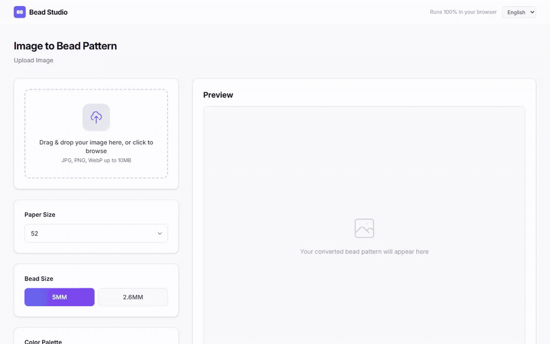
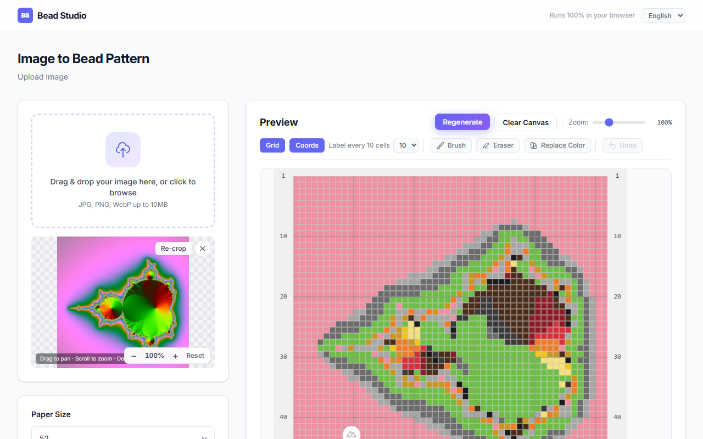
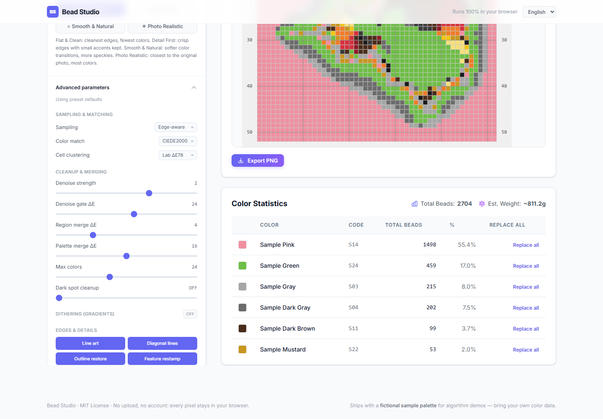

# Bead Studio

<p>
  <a href="./README.en.md">English</a> · <a href="./README.md">简体中文</a>
</p>

**把任意图片变成拼豆图纸 —— 全程在浏览器里完成。**

拖入图片、选一个图纸宽度，得到一张带色号的拼豆图纸：可以在画布上逐格改色，最后导出高分辨率 PNG。不登录、不上传、无后端：每个像素都在本地用 Canvas API 处理。



<sub>录制所用源图：[`docs/demo-source.png`](docs/demo-source.png) —— 用 ffmpeg 生成的合成分形图，仓库不包含任何第三方图片。</sub>

## 在线体验

| 类型 | 链接 | 说明 |
|---|---|---|
| 🖥 静态演示 | **https://loginleng.github.io/openBead/** | 由本仓库构建的 GitHub Pages 演示 |
| 🎨 线上工具 | **https://perlerhome.com/pages/image-convert/index** | 基于同一引擎的线上 H5 服务，打开即用，无需登录 |
| 🏠 产品介绍 | **https://perlerhome.com/intro** | 基于同一套转拼豆能力构建的门店经营系统 |

本仓库是该转换引擎的独立实现，可直接本地运行，也可部署为任意静态站点。

## 功能



- **图片 → 图纸**：拖拽 / 点击上传，裁剪支持缩放与平移 —— 任何改动（图纸宽度、色板、风格、高级参数）都会**自动重新生成**图纸。
- **尺寸**：52 / 78 / 104 列；高度按原图宽高比自适应。
- **色板**：可插拔的色板，支持「套装」（色板的子集）。
- **配色算法**：RGB 欧氏距离 / Lab ΔE76 / **CIEDE2000**，可切换。
- **图纸风格**：`扁平简洁` / `细节优先` / `平滑自然` / `照片写实` —— 每档是一组「采样 + 降噪 + 色号合并」参数的预设（见 `PATTERN_STYLES`）。
- **高级参数**：预设涉及的全部参数均已开放 —— 采样方式、配色匹配（CIEDE2000 / ΔE76 / RGB）、格内聚类、降噪强度与闸门、区域/色号合并、色号上限、暗点清理、抖动（强度、色号池、梯度选通）以及四个描边开关（线稿分层、斜线补充、轮廓还原、特征回贴）。预设仅提供默认值；任何修改都会标记为「已改 N 项」，并支持一键恢复预设。

  
- **编辑**：1/3/5/7 格画笔、橡皮擦、单格替色、整色替换、撤销。
- **辅助**：每 10 格参考网格、四周行列坐标（步长可调）、缩放。
- **统计**：各色号颗数、总颗数、估重、成品尺寸（cm）。
- **导出**：PNG 自带坐标与色号（导出格尺寸自动选择，保证色号可读）。示例输出：[`docs/export-sample.png`](docs/export-sample.png)（52 列，2568×2732 px）。

## 快速开始

需要 **Node.js 20.19+**（或 22.12+），无其它前置条件。

```bash
git clone https://github.com/loginleng/openBead.git bead-studio
cd bead-studio
npm install
npm run dev      # http://localhost:3000/openBead/ （base 与 GitHub Pages 子路径一致）
```

配置到此为止 —— **无需 `.env`、无数据库、无 API Key**。编辑器就是站点首页，没有路由跳转。

> `pnpm` / `bun` 也可以安装。仓库的 `.npmrc` 固定了 `legacy-peer-deps=true`，用于绕开 npm 10.8 依赖解析器的一个崩溃（它处理不了 vitest 的可选 peer）；两种方式装出的依赖树完全一致。

```bash
npm test          # vitest：算法主链 + 单元测试
npm run build     # 静态构建 → dist/（GitHub Pages / 任意 CDN）
```

## 色板：接入你自己的数据

> 仓库自带**虚构示例色板**（36 色、虚构品牌与色号），仅用于演示算法。
> 实际生产请把 `utils/palettes-data.ts` 换成你自己的色板 —— **本项目不包含任何真实品牌的色号表。**

替换步骤：

1. 编辑 `scripts/palettes.input.json`（格式见 `scripts/gen-palettes.mjs` 顶部说明）—— 每个颜色只需 `code` 与 `hex`；`name` 可选，`price` 保持 `null` 即可。
2. 运行 `npm run gen:palettes`。它会重新生成 `utils/palettes-data.ts`（并从 `hex` 推导 `r/g/b`，数据不会漂移）。
3. 也可直接修改 `utils/palettes-data.ts` —— 它是一个普通的 TypeScript 常量。

请保持色号**稳定**：图纸存的是色号而不是 RGB，改色号名会让旧图纸失效。

## 算法说明

`utils/bead-algorithm.ts` 是核心模块（约 4k 行，除一个画布辅助外无网络 / DOM 依赖）。`convertImageToBeadPattern` 的流水线如下：

1. **适配源图**（超过像素预算时分级面积降采样，细描边得以保留）。
2. **检测**小特征（眼睛/圆点）与描边掩码（在源分辨率上进行）。
3. **逐格降采样**：默认边缘感知加权量化；「平滑 / 照片」档使用面积平均 / 主色 / 中位数采样。
4. **量化**每格到最近的色板色，随后执行降噪、区域合并、全色板合并。
5. **可选抖动**，带梯度选通（仅缓变渐变参与抖动，硬边缘不参与）。
6. **回贴**小特征、对称校正、轮廓还原、暗点清理、色号数上限。
7. **统计**每色号颗数，返回 `{ pattern, stats, totalBeads }`。

`pattern` 是色号组成的 `string[][]`（空格为 `'TRANSPARENT'`）—— 这是算法、画布渲染器与导出器之间唯一的交换格式。

## 项目结构

```
bead-studio/
├─ index.html                     # SPA 入口（标题 / meta / 字体预加载）
├─ main.ts                        # createApp + vue-i18n（语言跟随浏览器，不持久化）
├─ App.vue                        # 布局（Header / 编辑器 / Footer）
├─ vite.config.ts                 # Vite + 自动导入 + 组件免注册
├─ pages/tool/image-to-bead.vue   # 编辑器页面：状态、转换、接线
├─ components/tool/
│  ├─ Toolbar.vue                 # 视图开关 · 工具 · 笔刷设置 · 撤销
│  ├─ BeadCanvas.vue              # 画布渲染 + 滚轮缩放 / 平移 / 悬停 / 涂画
│  ├─ ExportBar.vue               # 导出按钮（调 utils/bead-export）
│  ├─ CropDialog.vue              # 裁剪弹窗（可拖动、可缩放的选框）
│  ├─ ColorDialog.vue             # 选色弹窗（画笔 / 替色 / 整色替换）
│  ├─ UploadDropzone.vue          # 上传区 + 预览（缩放平移）
│  ├─ SettingsPanel.vue           # 单卡片分段布局：基础 · 色板 · 风格 · 高级（默认收起）
│  ├─ AdvancedSettings.vue        # 全部图纸参数，分组展示，带预设差异徽标
│  ├─ PatternStatsCard.vue        # 颗数统计表
│  └─ ColorPicker.vue             # 色块网格
├─ composables/useScrollLock.ts   # 弹窗滚动锁定
├─ i18n/locales/{en,zh}.json      # 界面文案（仅 tool.*）
├─ utils/
│  ├─ bead-algorithm.ts           # 转换 + 统计 + 导出尺寸（核心）
│  ├─ bead-canvas.ts              # 随格子等比缩放的线宽 + 辅助网格/坐标
│  ├─ bead-export.ts              # 组装导出 PNG（图纸 + 坐标 + 统计区）
│  ├─ pattern-params.ts           # 预设 → 可编辑参数组（差异统计 / 重置）
│  └─ palettes-data.ts            # 生成的示例色板（请替换）
├─ scripts/gen-palettes.mjs       # JSON → palettes-data.ts
├─ scripts/palettes.input.json    # 色板输入示例
└─ tests/                         # vitest，node 环境
```

数据单向流动：`pattern`（色号组成的 `string[][]`）只存在页面里，组件要么读它（`BeadCanvas`、`ExportBar`、`PatternStatsCard`），要么发意图（`Toolbar` 开关、`BeadCanvas` 的涂画/选色事件、`CropDialog` 确认）。只有页面会改 pattern、重算统计 —— 不存在第二份数据源。

## 测试

```bash
npm test
```

覆盖重点是算法核心链路：

- `tests/algorithm-chain.test.ts` — 降采样 → 量化 → 抖动 → 统计 → 导出尺寸的不变量（四档风格、确定性、`TRANSPARENT` 处理、色号上限）。
- `tests/bead-export.test.ts` — 导出统计区排版（行列计算、压缩上限）。
- `tests/pattern-params.test.ts` — 预设 → 参数摊平（各档取值、差异计数）。
- `tests/image-to-bead.test.ts`、`tests/helpers/color-utils.test.ts` — 辅助函数（降噪、主色提取、最近色）。

`createBeadCanvas`（DOM `<canvas>`）没有单元测试 —— 它需要真实的 canvas 上下文。

## 说明

- 全部计算在主线程完成：超大图纸（100+ 列）在低端设备上生成耗时会有所增加，但不会永久阻塞界面。
- 仓库中的色板均为虚构示例数据（虚构品牌与色号），不包含任何真实品牌的色号表。

## License

[MIT](LICENSE)
